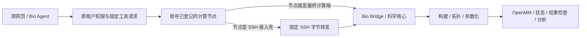

# Bio 网页与远程工作流

当前源码状态为 `IMPLEMENTED_LOCALLY_NOT_ACCEPTED`。本轮不部署服务器、不请求在线模型、不运行 MD；页面交互、原登录及计算端验收留到下一阶段。旧报告只适用于其中记录的版本。

## 网页使用

1. 在原网页选择 Bio Agent，进入会话后点击顶部的 **Bio 任务**。
2. 如果研究标准蛋白或小肽，上传 PDB / ENT，单文件最多 64 MB。普通聊天附件不会自动导入科学项目。独立小分子可以直接在对话中提供结构描述，受现有参数化范围限制。
3. 回到对话说明研究目标，Agent 检查输入并推荐条件。需要 GPU 时，可在 Bio 任务中选择操作者已授权的 CUDA 设备、精度及 CPU 线程数；资源偏好仅用于后续新方案。
4. Agent 生成草案后，在 Bio 任务中选择该方案并查看完整参数。核对结构、温度、时长、力场、分析选择、最终计算目标和预算，勾选确认后批准此版本。
5. 批准只产生 READY。需要开始时，另行点击 **提交计算**，或者在对话中明确要求提交已批准的方案。
6. 运行状态会定期刷新。资源不足时显示等待；可以查询、取消或恢复并核对原任务。副作用响应未知时先恢复，不换工作流 ID 重提。
7. 在 **计算结果** 选择已完成阶段，按需下载产物。文件留在计算端，浏览器只取所选文件。分块及完整文件检查通过后才完成保存；超过 128 MB 的文件需要浏览器直接保存到文件的功能，否则使用计算端已有的文件传输方式。

## 执行分工

科学依赖、结构、拓扑、数据库、轨迹、checkpoint 和结果检查均在最终计算端。网页服务器保留会话所有权、请求收据和展示信息；接入壳只使用标准库网关与现有 SSH 配置。传输失败不会回退网页服务器运行。

远端进程先完成连接和 spawn 回执，再按顺序发送输入与 EOF。冷启动可以直接发起 Bio 身份检查和状态核对；启动拒绝、断线或取消会结束本地句柄并报告失败或未知结果。收到迟到的取消任务 spawn 回执后仍会请求终止远端句柄，不能据此宣称计算已经停止。

## 授权与恢复

新授权包含完整方案版本、输入集合、科学实现、环境和 `executionTargetSha256`。计算目标包含租户、登记节点、最终主机身份、运行账户、Python、版本目录、计算根和资源策略。模型不能修改这些部署字段，模型工具中也没有审批或任意文件操作。

页面人工审阅会重新检查输入与环境，并绑定审阅快照。环境、版本或目标改变后，旧确认不能提交。旧的无目标绑定授权不自动升级；已有数据保留，需生成新版本重新审阅。项目一经绑定最终目标，不允许原地改成另一个目标。

已收到并确认的提交保存耐久活动记录。Bridge 断开后按固定连接重建，先读取原状态，在原授权和原截止时间内继续推进；重连不会重放 submit 或扩大预算。未知 worker 保留资源租约。人工恢复核对已存在且状态确定的 attempt，可以继续后续阶段；确认没有启动的任务仍需单独点击提交。

截止时间包含排队时间。预算耗尽、取消或停止推进后，未占用的排队记录释放；已启动或未知的 worker 仍保留配额，直到确认终态且进程已退出。状态仍未知、目标不匹配或环境改变时继续拒绝推进。

## 资源和性能

构建、最小化与分析在计算端 CPU 上执行，动力学及验证按方案使用 CPU 或 CUDA。GPU 只能选目标策略列出的设备，不能仅凭“GPU 服务器”就认定已启用 CUDA。二进制 checkpoint 同时检查平台、设备、精度、硬件、软件、模型及动力学兼容性；跨平台续跑应选择受支持的 State 路径重新生成并审阅方案。

同一计算账户可为多个 Bio 项目配置共同的私有 `quotaRoot`，统一排队 CPU 总线程、并发阶段数和 GPU 独占租约。该池只管理使用此策略的 Bio 项目；它不自动管理 LAMMPS、跨 Unix 账户作业或 Slurm/PBS。操作者应为 Bio 分配配额，或将原平台资源裁决接入权限适配器。

仍在排队的工作流需要先取消，再创建新版本；取消会保留已有记录和结果。已批准但尚未提交、也未领取资源的方案仍可创建新版本，新版本需要重新审阅批准。运行中或状态未知的 worker 继续保留租约。

环境探测缓存文件 SHA-256，每次仍枚举实现与数据文件，并检查 inode、大小、mtime、ctime 和权限。文件修改、更换、增加或删除都会重新计算环境身份，缓存不会延长原授权。

外部结构导入仍限单文件 64 MiB。已经检查过的阶段产物、续跑和恢复文件按原阶段输出预算与目标策略上限传输，不再套用结构导入上限。自动输出预算使用操作者配置的有限目标上限。传输前检查整个依赖包（含 manifest）的总大小，传输时仍逐文件验证 SHA-256 并使用有界分块；预算不足时拒绝推进。

## 尚待部署配置

原网页账号/租户和登记节点、最终计算主机身份、运行账户及路径、资源配额、原权限适配模块需由后续接入阶段提供。原平台必须保留已认证的每租户网关；浏览器 Host/Origin 防护不等于用户认证。服务器插件在缺少平台权限适配器时默认拒绝。

这些参数化接口与离线替身检查不证明真实 SSH、Linux/CUDA、生产多租户隔离或科学采样已经验收。科学范围仍为现有标准蛋白、小肽、限定独立小分子、蛋白外配体、水盒及续跑；核酸、膜、金属中心、结合姿态导入、对接和结合自由能需要另行开发。
# 网页显示派生

结构与真实轨迹预览的来源校验、原子筛选与 XTC 派生均在最终计算节点进行。控制/接入端仅处理权限、固定 Bridge 转发和共享发送预算；节点离线时没有本机科学处理回退。显示任务与 MD 阶段共用 CPU/并发资源池，但不产生科学审批或计算提交。详见 [网页预览说明](web-visualization.md)。
