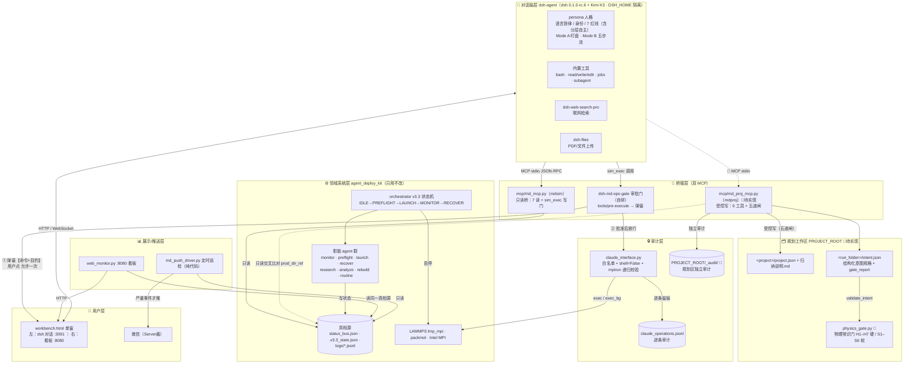

# dsh-agent 分子模拟智能体 · 设计思路与架构详解

> [!info] 一句话
> 给一套已经能跑的 LAMMPS/ReaxFF 编排系统，装一颗**"会讲理、能动手、每步留痕"**的对话脑。

> [!success] 2026-08-19 架构更新
> ① 人格新增**红线 7「分层自主」**：方案内自主执行、方案外（科研方向级）停下等拍板；
> ② 新增**已定稿待实现**的一套设计（`docs/设计_任务管理_意图规格_物理门.md`，已经过两镜头对抗校验）：**三分树物理隔离 + 受控写 MCP `mdproj` + 结构化意图规格 intent.json + 物理常识门 H1–H7/S1–S6 + 归纳说明自动生成 + Mode B 五步流改造**。本文档已按新架构重写，待实现部分均有标注。

---

## 一、项目定位与背景

### 1.1 已有的领域系统（被"套壳"的对象）

`agent_deploy_kit_20260630` 是一套**不依赖大模型也能自主运转**的 LAMMPS/ReaxFF 分子动力学编排系统：

- **orchestrator v3.3**：确定性状态机，调度十几个职能 agent，把模拟从建盒一路管到产物分析；
- **StatusBus（`status_bus.json`）**：各 agent 上报状态的总线文件；
- **`.v3.3_state.json`**：编排器的持久化状态（相位/任务/恢复历史）；
- **Web 看板（`web_monitor.py`）**：8080 端口的实时大屏；
- **`claude_interface.py`**：预留给 AI 的审计写口。

这套系统把"模拟跑起来、出问题自愈"干得很好，但它不会**解释**：为什么进 RECOVER？这次爆炸和上次是不是一个原因？这篇新文献该怎么建模？——这些需要判断和语言能力的部分，正是对话脑的位置。

### 1.2 对话脑是什么

dsh-agent 是基于 **dsh（DeepSeek Harness）0.1.0-rc.6 + Kimi K3** 的对话智能体，部署在与模拟真机同一台 Linux 上，通过 **MCP 桥**直连领域系统的真相源文件。对用户呈现为一个中文对话助手（"分子模拟助手"），两种工作模式：

- **Mode A 盯盘诊断**：巡检模拟状态、诊断异常、讲清机理、给出下一步建议；
- **Mode B 文献解读**：读论文 → 结构化意图规格 → 物理门校验 → 建模思路 + 动力学方案骨架。

---

## 二、设计思路（七条原则）

### 原则 1：套壳，不重做

领域系统已经能跑，对话脑**只用不改**——不修改 orchestrator 的决策逻辑，不接管相位流转，不另起一套状态管理。对话脑只做领域系统做不了的三件事：

1. **把状态/日志读成人话**（"network_6000 健康，55.3%；gentle_compress 温度 62556K = 能量爆炸"）；
2. **诊断与讲理**（异常根因是 ensemble 选择、QEq 不收敛还是结构非物理）；
3. **把用户确认过的方案安全落地**（走审计通道执行）。

好处：领域系统的确定性不受 LLM 幻觉影响；对话脑出 bug 也不会搞坏模拟。

### 原则 2：确定性归机器，判断归模型

| 归机器（确定性） | 归模型（非确定性） |
|---|---|
| 相位流转 IDLE→…→RECOVER | 异常根因诊断、机理分析 |
| 重试策略选择与执行 | 文献解读、建模/动力学方案设计 |
| 状态采集与告警检测 | 风险判断、下一步建议 |
| 审计落盘、物理门判定（纯函数） | 与人对话、把方案拆成命令清单 |

两边通过**文件真相源**解耦：状态文件（`status_bus.json` / `.v3.3_state.json`）和日志（`*.jsonl`）是双方共同的语言。机器写，模型读；模型要动手，走唯一写门。

### 原则 3：真相源唯一——只信 ground truth，不信模型的嘴

> [!quote] 第一原则（交接文档卷首）
> 只信 ground truth（状态文件/工具返回），不信模型的嘴；凡"配置存在≠接线了"，改任何配置都要起进程验证生效。

落到人格红线第 3 条：数字必来自工具真返回（step / 温度 K / 密度 / pct / case_id / 策略编号），**查不到就说查不到，绝不编造模拟数值**。每个 MCP 工具的返回都带 `_discipline` 字段再次提醒模型这条纪律。

### 原则 4：能力全给，出口上锁

对话脑与 Claude Code 能力平权（bash、read/write/edit、后台任务、子代理、联网检索），但**写路径层层设卡**，四道防线：

```
① 沙箱层    DSH_PERMISSION_MODE=workspace-write：工作区内随便写，
            工作区外（程序运行-case/、agent_deploy_kit）的写触发升权审批
② 审批门    dsh-md-ops-gate：sim_exec 调用被 tools/pre-execute 拦截，
            强制弹窗，用户点【允许一次】才放行
③ 审计通道  claude_interface.py：可执行文件白名单 + shell=False 防注入
            + mpirun 启动目标递归校验 + 逐条写 claude_operations.jsonl
④ 人格纪律  高危操作先讲后果再确认；被拒绝即停，绝不换工具绕过
```

> [!warning] fail-closed 兜底
> headless（无弹窗应答者）场景下审批门**自动拒绝**所有写操作——没人能批准，就谁也别想写。

### 原则 5：分层自主——方案内自主，方案外拍板（红线 7，2026-08-19 新增）

自主不是开关，是**分层**的。同时满足全部四个条件的，助手可**自主决策执行、做完汇报**：

1. 不改变化学模型（分子种类/缩聚度/交联/端基/组分配比）；
2. 不动 ffield.reax 力场；
3. 有备份可回滚；
4. 在已确认方案框架内（重试、参数微调、换系综/timestep 等策略层调整）。

**任一不满足即为科研方向级决策**（换分子模型、重建网络化学、改研究目标）——必须停下，给出带证据的建议书（现象解释+候选路径+各自风险），等用户拍板，绝不自己开跑。

> [!important] 金句
> 自动审批开着也不例外——**省点击不省判断**。

### 原则 6：人格即纪律，双入口逐字一致

dsh 有两个入口：**web**（浏览器对话，走 `.dsh/.agent-presets/md-sim-assistant/agent.cordis.yml` 全量合成）和 **headless**（命令行/程序化调用，走 `md-sim-assistant.headless.patch.yml` 按 id 覆盖）。两个文件接线形态不同，但**人格文本逐字一致**，每次改动后用脚本 diff 验证（见 [[#病灶 D-03|D-03]]；红线 7 加入后已验证 PERSONA-IDENTICAL）。

### 原则 7：三分树物理隔离（2026-08-19 设计定稿）

```
AGENT_BASE（harness 代码）∥ RUN_CASE_BASE（LAMMPS 真相源产物，编排器管）∥ PROJECT_ROOT（agent 的意图/规划工作区）
```

- 只读 mdsim 桥**保持零写**，只认 `local_base`（模拟真相源），**绝不**给它加 PROJECT_ROOT 分支（ssh 模式下 agent 端 PROJECT_ROOT 在 Windows、够不到 remote_base）；
- 另设一个与只读桥**分离**的受控写 MCP（`mdproj`），只做两件事：PROJECT_ROOT 内 mkdir、写 *.json 骨架；
- agent 的"项目/任务文件夹"是**规划工作区**，不是 LAMMPS 运行目录；prod_dir 仍由编排器落 RUN_CASE_BASE，agent **只引用指针不搬动**（跨系统唯一可靠连接 = `intent.prod_dir_ref` 绝对指针）。

另有隔离底线：独立 `DSH_HOME`、凭证 chmod 600 不入 git、MCP 桥双模式（local/ssh）跨平台可移植。

---

## 三、总体架构（分层）



> [!note]- 纯文本版（无 Mermaid 环境时看这里）
> ```
> ┌───────────────────────────────── 用户层 ─────────────────────────────────┐
> │  workbench.html 单窗（浏览器）：左 dsh 对话 :3091 ｜ 右看板 :8080          │
> │  + 微信（严重告警推送，Server酱）                                         │
> └──────────────┬───────────────────────────────────────┬──────────────────┘
>                │ HTTP / WebSocket                      │ HTTP
> ┌──────────────▼───────────────── 对话脑层（dsh-agent）───────────────────┐
> │  dsh 0.1.0-rc.6 隔离实例（DSH_HOME 锁定 · Kimi K3 · workspace-write）    │
> │   ├ persona 人格：语言铁律 / 身份 / 7 红线（含分层自主）/ Mode A·B        │
> │   ├ 内置工具：bash · read/write/edit · glob/grep · jobs · subagent       │
> │   └ 插件：dsh-web-search-pro（联网） · dsh-files（文件上传）              │
> │           · dsh-md-ops-gate（审批门·自研）                               │
> └──────┬──────────────────────────────────────────────┬──────────────────┘
>        │ MCP stdio JSON-RPC                            │ tools/pre-execute 拦截
> ┌──────▼──────────── 桥接层（双 MCP）─────────────────▼──────────────────┐
> │  ① mdsim 只读桥（md_mcp.py）：7 只读工具 + sim_exec 唯一写门             │
> │     sim_exec ──▶ dsh-md-ops-gate 审批门 ──①弹窗──▶ 用户【允许一次】      │
> │  ② mdproj 受控写桥（md_proj_mcp.py）🚧待实现：6 工具 + 五道闸            │
> │     只做两件事：PROJECT_ROOT 内 mkdir / 写 *.json 骨架                   │
> └──────┬───────────────────────┬──────────────────────┬──────────────────┘
>        │ 只读                   │ 批准后                │ 受控写
> ┌──────▼───────┐      ┌────────▼─────────┐   ┌────────▼─────────────────┐
> │ 真相源（只读）│      │ 审计层            │   │ 规划工作区 PROJECT_ROOT 🚧│
> │ status_bus   │      │ claude_interface │   │ <project>/project.json   │
> │ .v3.3_state  │      │ 白名单+shell=False│   │ <run_folder>/intent.json │
> │ logs/*.jsonl │      │ → claude_ops.jsonl│   │ 归纳说明.md（自动生成）   │
> └──────▲───────┘      └────────┬─────────┘   │ physics_gate 物理门 🚧    │
>        │                       │ exec/exec_bg │ _audit/（独立审计）🚧     │
> ┌──────┴───────────────────────▼─────────────┴──────────────────────────┐
> │        领域系统层 agent_deploy_kit（只用不改）                           │
> │  orchestrator v3.3：IDLE→PREFLIGHT→LAUNCH→MONITOR→RECOVER              │
> │   MONITOR 五子相位：OBSERVE→ANALYZE→DETECT→EVALUATE→DECIDE（30s/tick） │
> │  职能 agent 群：monitor·preflight·launch·recover(A–E)·research·        │
> │   analyze·rebuild·routine_engine·auto_next_task                        │
> │  算力：LAMMPS lmp_mpi · packmol · Intel MPI                            │
> │  产物落 RUN_CASE_BASE（程序运行-case/，编排器管，agent 只引用指针）      │
> └──────────────────────────────┬─────────────────────────────────────────┘
>                                │ 轮询读同一真相源
> ┌──────────────────────────────▼ 展示/推送层 ────────────────────────────┐
> │  web_monitor.py :8080 看板（case 卡片 / 任务详情 / 与 MCP 同源）         │
> │  push/md_push_driver.py 定时巡检（纯代码）→ 严重推微信 / 常规进处理层     │
> └─────────────────────────────────────────────────────────────────────────┘
> ```

---

## 四、对话脑层详解

### 4.1 dsh 底座与部署形态

- dsh 0.1.0-rc.6，`pnpm` 本地安装，`DSH_HOME` 锁定为项目内 `.dsh/`；
- 启动器 `run-dsh.sh`：锁定 `DSH_PERMISSION_MODE=workspace-write`、node 22.19 PATH（系统 node 缺 `createZstdDecompress`）；
- 模型：Kimi K3（kimi-coding provider），凭证在 `.dsh/.credentials.yaml`；
- 两个 profile：**web**（:3091 浏览器对话）和 **headless**（命令行探针/脚本调用），共享同一份人格文本。

### 4.2 人格系统（agent.cordis.yml 的 text 段）

人格是对话脑的"操作系统"，按优先级分层：

> [!important] 【语言铁律·最高优先】
> 放人格最顶端。harness 系统提示和工具说明全是英文，K3 默认跟英文思考；实测放在身份段里力度不够（注入了但没被执行），抽成独立段放顶端并加重措辞（"一个字英文思考都不允许，思考前先自检"）后，reasoning 才稳定转中文。

**【身份】**——一句话身份（"分子模拟(LAMMPS/ReaxFF)运维助手"），并明确**定位边界**：不重做编排（那是状态机的红线）、不碰 LAMMPS 计算本身（输入/data/力场是科研红线）；价值在于连真相源、读人话、讲机理。

**【红线】7 条**：

1. **全能力、全责任**：能力与 Claude Code 同级，但改 LAMMPS 输入/data/力场、杀进程、动 state、删移文件——先讲清后果，用户确认（对话确认或弹窗批准）后才动手；
2. **方案先行、确认即执行**：先给诊断+命令清单；用户说"确认/没问题"后直接执行到底——模拟命令走 sim_exec 审计，一般工作直接 bash/write/edit；长任务后台起并回报 PID+日志；
3. **数字必来自工具真返回**，查不到就说查不到；
4. **高危操作清单**（`kill_lammps / modify_data / modify_input / restart_simulation / change_forcefield / add_atoms / change_box / clear_output`）必须先讲后果再等确认；
5. **诊断讲机理**：区分 ensemble 选择问题（NVE 自热爆炸 / NPT 压塌非平衡碎片）、QEq 不收敛、结构非物理（碎片堆积、密度不符）——对齐系统积累的故障诊断经验；
6. **不迎合**：数据说爆了就报爆了（如温度 6 万 K），绝不因用户期待美化；
7. **分层自主（方案内自主，方案外拍板）**：见 [[#原则 5：分层自主——方案内自主，方案外拍板（红线 7，2026-08-19 新增）|原则 5]]——四条件全满足可自主执行做完汇报；任一不满足（科研方向级）停下给建议书等拍板；自动审批开着也不例外，省点击不省判断。

**【Mode A：模拟巡检·固定套路】**——用户说"巡检/什么情况/跑到哪了"时按写死顺序执行：

```
① sim_status      各 case 状态/步数/pct/温度/异常，先点 CRITICAL
② sim_context     相位 + 当前任务 + 恢复次数
③ 若有异常/RECOVER → sim_context(section=strategy/orchestrator) 找根因
④ 出诊断：谁健康谁危险、机理是什么、建议下一步
⑤ 全程数字带出处；要动手先讲后果、确认后执行
```

**【Mode B：文献解读 → 五步流】**（🚧 ②.5/②.9 门控环节随 mdproj 落地后生效）：

```
① 读文献 read_paper：体系/目标性质/已报道方法/关键数值
② draft_intent：把模型对物理意图的理解落成 intent.json（DRAFT）🚧
②.5 用户确认门：回显 declared_net_charge / density_range / protocol_flags /
    系综序列 / timestep 等基准字段，ask_user 确认 → status=CONFIRMED 🚧
②.9 物理常识门 validate_intent：H1–H7 硬拦（不过则阻断带违规回退）、
    S1–S6 软警示 → GATED_PASS 🚧
③ swarm 拆解（以 GATED_PASS 的 intent.json 为输入契约）：
   · 意图与目标面
   · 结构建模面：初始构型/组分配比/密度目标/端基/预防 close contacts<0.8Å
   · 力场面：ReaxFF ffield.reax 元素覆盖（本系统 C/H/O/N/P/Si）、QEq 电荷中性
   · 动力学面：系综序列(minimize→NVT/Langevin 预平衡→NPT 生产)、温压程序、
     timestep(ReaxFF 0.1–0.25 fs)、平衡判据、生产步数，对齐已有 case 口径
   · 分析面：密度/RDF/键/模量，对应 cp_calculator/frame_extractor/analyze_agent
④ 综合输出【建模思路】+【动力学思路】（草案落 inputs/，不执行）
⑤ 纪律：文献数值标出处；方案对齐已有 case 注差异；确认后经 sim_exec 逐步落地
```

**【联网检索·决策辅助】**——诊断具体报错（bondchk failed / QEq not converged / lost atoms / TotEng 爆炸 / close contacts）时主动查 LAMMPS 官方文档 > 邮件列表/matsci 社区 > 一般博客；检索内容是参考不是真相源，引用标来源和置信度。

### 4.3 插件

| 插件 | 来源 | 职责 |
|---|---|---|
| **dsh-md-ops-gate** | 自研（`dsh-plugins/`） | 审批门。挂 `tools/pre-execute` 事件，拦截 `mcp__mdsim__sim_exec`，返回 `{kind:'ask'}` 把命令+目的组装进弹窗 reason；web profile 有 UI 应答者→弹窗；headless 无应答者→fail-closed。零依赖，经 `cordis.patch.yml` 的 insert 挂载。 |
| **dsh-web-search-pro** | 社区 | 联网检索（DuckDuckGo/Bing/Jina 多引擎免 key），`web_search_pro`/`web_fetch_pro` 两工具。其 patch 自动注入 `@vendor/dsh-browser`（**browser 不能再进 bundles，否则 duplicate loader 启动失败**）。 |
| **dsh-files** | 社区（taxueseek） | 文件上传双面插件：前端回形针/拖拽上传（≤25MB，存会话工作区 `.dsh-filess/<sid>/`，7 天 TTL）+ `read_document` 工具（PDF/DOCX/XLSX/TXT，GB18030 编码嗅探）。补上了 dsh 原生附件只收图片（PNG/JPG/WebP/GIF 硬编码）的缺口。 |
| 内置工具 | dsh 自带 | bash（含 `run_in_background` + `job_output`/`job_kill`）、read/write/edit、glob/grep、subagent swarm。注意 dsh-web-app 层默认全关，preset 必须 `disabled:false`+`name:` 显式翻回。 |

---

## 五、桥接层详解：双 MCP 架构

> [!note] 2026-08-19 起桥接层从单桥变双桥
> 只读桥 `mdsim`（现状，零写）与受控写桥 `mdproj`（🚧已定稿待实现）**物理分离**——只读桥永远零写，写能力收拢在一个只暴露两个动作（mkdir / 写 json 骨架）的独立 MCP 里。

### 5.1 只读桥 `mcp/md_mcp.py`（mdsim，现役）

422 行、零第三方协议依赖的 MCP stdio 服务器（换行分隔 JSON-RPC 2.0，日志走 stderr 绝不污染 stdout；启动即锁 UTF-8 防 Windows GBK 崩——见 [[#病灶 D-04|D-04]]）。

**双模式读取**：

- `mode=local`：直读 `md_config.json` 里 `local_base` 下的真相源文件（当前形态，真机本机）；
- `mode=ssh`：paramiko 连远程 Linux 执行 `cat`/`tail` 只读拉取（Windows 工作站形态）。`sim_exec` 仅 local 模式开放。

**八个工具逐个**：

| 工具 | 读的文件 | 返回要点 | 何时用 |
|---|---|---|---|
| `sim_status` | `status_bus.json` | 每 case：status/step/total/pct/temp_k/stage/anomalies + 系统负载；兼容扁平与子阶段两种总线格式 | "模拟跑到哪了/有没有异常"第一站 |
| `sim_context` | `.v3.3_state.json` + 审计流水末 n 条 | phase、monitor_subphase、当前任务（case_id/步数/核数/元素）、recovery_count、最近操作 | "现在在哪个阶段、任务是什么" |
| `sim_context` section=strategy | `logs/strategy_decisions.jsonl` 末 n 条 | 相位流转 from→to + trigger + decision + 策略(A/B/D/E/F) + 第几次尝试 | "为什么进 RECOVER、换了什么策略" |
| `sim_context` section=orchestrator | `logs/orchestrator_v3.3.jsonl` 末 n 条 | 状态机流转行（OBSERVE→ANALYZE→…）、alive/frozen | "编排器最近在干嘛" |
| `read_paper` | 文献文件 | 正文文本（PDF 先 pypdf、抽不出 200 字符走 pdfplumber 兜底并标注"可能扫描件"；docx 用 python-docx；其余按文本），max_chars 默认 60000 | Mode B 入口 |
| `sim_exec` | —（**唯一写门**） | 转发给 `claude_interface.py exec/exec_bg`，解析其 stdout 的 JSON 返回；附加 audit_log 路径 | 用户确认方案后的每一步执行 |

所有返回都带 `_discipline` 字段；每次调用记 `_toolcalls.jsonl`（工具名/参数/返回键），可审计模型到底查了没有。

**sim_exec 参数**：`cmd`（必填）、`description`（进弹窗和审计日志）、`cwd`（`shell=False` 下 `cd/&&/|` 不生效）、`background`（true 走 exec_bg 后台，回 PID+日志路径）、`log`（后台日志路径）。前端超时 360s。

### 5.2 受控写桥 `mcp/md_proj_mcp.py`（mdproj，🚧已定稿待实现）

独立 MCP（serverName=mdproj，自带 config 含 PROJECT_ROOT，**不进 md_config.json**），支撑"项目/任务文件夹管理 + 结构化意图规格"：

**六个工具**：

| 工具 | 写? | 说明 |
|---|---|---|
| `list_projects` | 否 | 列 PROJECT_ROOT 下项目 + project.json 摘要（写 MCP 自己实现，不复用只读桥） |
| `task_status` | 否 | 读 intent.json + 交叉 status_bus.cases[case_id]；并入实时态前先比对 .v3.3_state 的 live prod_dir 与 intent.prod_dir_ref 一致，否则显示"无对应活动 run" |
| `draft_intent` | **是** | Mode B/描述 → intent.json（DRAFT） |
| `validate_intent` | 否 | 跑 H1–H7 硬门 + S1–S6 软门 → gate_report（纯计算） |
| `new_project` | **是** | mkdir PROJECT_ROOT/\<project\> + project.json 骨架 |
| `new_task` | **是** | mkdir \<project\>/\<run_folder\>/{inputs,logs,results} + intent.json 骨架 + 追加 project.json.case_ids |

**受控写五道闸**（对抗校验后的修正版）：

1. **realpath 限域**（不是字符串 `..` 检查）：目标路径 `os.path.realpath` 规范化 → 断言在 `realpath(PROJECT_ROOT)` 内；任一段是符号链接则拒；
2. **标识符白名单**：project/case_id 只允许 `[A-Za-z0-9_\-]`；**来自 read_paper 的不可信文本永远不能直接当路径**，必须过校验 + 用户确认双闸；
3. **JSON 内容写 = 单列受控原语**：过 realpath 限域 + audit + 写前 schema 校验（拒绝把绝对路径塞进 prod_dir_ref 等越界字段）；
4. **独立审计**：写操作落 `PROJECT_ROOT/_audit/`（**不复用** AGENT_BASE 锚定的 claude_operations，否则破物理隔离）；
5. **用户确认**：首个写回显目标路径讲清后果；Mode B 一次迭代的建项目+建任务+写 intent **批量预览一次性回显**（减确认疲劳）但保留最终确认。

**边界不变**：模拟真相源（status_bus/state/logs/prod_dir/data/ffield/production.in）永远只读；写只落 PROJECT_ROOT；`results/` 只做只读软链回 RUN_CASE_BASE（realpath 落点在 RUN_CASE_BASE 一律拒写穿透），或干脆只存字符串指针。

### 5.3 结构化意图规格 intent.json（🚧）

以 `case_id` 为公共外键，对齐 state.task + system_spec.schema + sim_config.schema。关键字段：

- `schema_version / case_id / project / created / status`（DRAFT→CONFIRMED→GATED_PASS/GATED_FAIL）/ `reproduce_or_improve`
- `source`（Mode B 出处：paper_path/doi/reported_method）
- `system`（molecule / target_elements / size.density_target / **declared_net_charge** / packmol_input）
- `objective`（simulation_goal / target_property / key_values+出处）
- `constraints`（temperature_range / **declared_density_range** / **protocol_flags{is_quench,has_heating_ramp}** / walltime / cores）
- `ensemble_sequence[]`（有序：minimize→pre_equil(nvt/langevin)→production(npt)；**H2/H3 判定的唯一真相源**）
- `key_params`（timestep_fs / total_steps / cores / forcefield{preferred,fallback} / units / pair_style）
- `prod_dir_ref`（运行后回填，**唯一跨系统链接**；agent 绝不反推 prod_dir 路径）
- `gate_report`（passed / hard_violations / soft_warnings / checked_at）

**文件夹层级**：

```
PROJECT_ROOT/
└── <project>/
    ├── project.json                # {project, created, case_ids[], registry_refs[]}
    ├── 归纳说明.md                  # ★自动生成
    └── <run_folder>/               # <case_id>_<YYYYMMDD>_<HHMMSS>（agent 本地标识）
        ├── intent.json             # 结构化意图规格 + 门校验报告
        ├── 归纳说明.md              # ★自动生成
        ├── inputs/                 # 拟提交草案（非真相源，不执行）
        ├── logs/                   # 起草/确认/门校验/审计流水
        └── results/                # 只读软链回 RUN_CASE_BASE（禁写穿透）
```

### 5.4 物理常识门 physics_gate.py（🚧纯函数，先写测试）

**硬门（违反必拦，不给方案）**：

| 门 | 内容 |
|---|---|
| H1 timestep | units real 时 >0.25fs 拦（一般）、>0.1fs 拦（压缩/成断键反应/高应变）；metal 制按 1e-3 ps 换算；与 ensemble_sequence 工况交叉核对 |
| H2 非平衡起点禁裸 NVE | 以 ensemble_sequence 为真相源：production 前无 minimize 也无控温则拦；**续跑豁免**（read_restart/read_data 且标注来自 CONFIRMED 前置平衡态） |
| H3 非平衡起点禁 NPT 硬压 | 决定性阻断 = 首个动力学段即 NPT AND 前无 minimize 与控温 AND 起点非平衡/碎片——**任意压强（含 1atm）都拦**；≥100atm 作为并列充分条件警示 |
| H4 近距接触 | data 按周期算 dmin；<0.8Å 且无 minimize/soft 预处理拦，<0.3Å 一律拦（金属短键须 intent 显式声明） |
| H5 净电荷 | Σq 与 declared_net_charge 比，固定小容差 ±0.5e（或 0.5×10^-p×√N）；**去掉随原子数线性放大的错误容差** |
| H6 QEq 不收敛 | 动态 grep 不收敛告警/迭代顶格；静态 tolerance>1e-6 或 maxiter 过小软告警 |
| H7 bondchk/lost atoms | 动态 grep（bondchk failed / lost atoms / atoms missing / Too many neighbor bins），出现即拦 |

**软门（警示不拦）**：S1 自热预警 / S2 密度落物理区间（用 declared_density_range；0.259/0.484/0.67 = 碎片中间态）/ S3 弛豫温度不趋 0K（排除淬火）/ S4 控温阻尼合理性（Tdamp≈100×dt）/ S5 neighbor 重建 / S6 单位制与 pair_style 一致（ReaxFF 用 real）。

**纪律**：不写死力场键级/价态/vdW 参数（ReaxFF 参数纪律）；所有 rationale 绑本项目实测事故（70 万 K 自热 / 密度 0.259/0.484/0.67 / QEq −0.81），非编造。

---

## 六、审计层详解：`claude_interface.py`（领域系统侧，已扩展）

定位：**Claude/对话脑与 v3.3 Orchestrator 之间的唯一写通道**。四条原原则：不直接操作文件/进程、决策基于真实 state、操作后回写+审计、压缩后靠审计日志恢复上下文。

### 6.1 防御机制

- **白名单**：`python3 ls cat tail head grep ps kill pkill cp mv mkdir echo wc find stat df du touch rm free uptime` + `packmol mpirun lmp_mpi lmp_serial sleep`。**故意不含 bash/sh/nohup/setsid/env**——它们是任意命令包装器，加了等于没白名单；
- **shell=False**：`shlex.split` 后 exec，元字符（`; | && $()`）只是字面参数，注入在能力路径上就不存在；
- **mpirun 递归校验**：跳过 `-np/-n N` 和 `--` 选项找到被启动程序，被启动者也必须在白名单——实测 `mpirun -np 1 bash -c id` 被拒并记 `exec_blocked`；
- **环境补全**：`_exec_env()` 给子进程 PATH 前置 Intel MPI 和 LAMMPS 二进制目录（扩 PATH 不扩大可执行集合，白名单仍按 basename 校验）；
- **审计**：`exec`/`exec_bg`/`exec_blocked` 逐条写 `logs/claude_operations.jsonl`（ts/actor/action/target/details 含 argv/cwd/pid），超 20MB 自动轮替，新建即 chmod 600。

### 6.2 两个执行入口

- `exec <cmd> <desc> [cwd]`：同步执行，300s 超时，返回 rc/stdout/stderr；
- `exec_bg <cmd> <desc> [cwd] [log]`：`Popen + start_new_session` 脱离父进程，stdout/stderr 重定向日志文件，立即返回 PID——552 万步热解这类长任务的唯一通道。

---

## 七、领域系统详解：orchestrator v3.3 与职能 agent 群

### 7.1 orchestrator（总调度状态机）

主循环节拍：MONITOR 相位 30s/tick，其余相位 10s/tick。状态持久化在 `.v3.3_state.json`（原子写 tmp+rename，防并发读到半文件）。

**相位机**：

```
IDLE ──task_registered──▶ PREFLIGHT ──passed/warning──▶ LAUNCH ──launch_success──▶ MONITOR
                            │                            │
                            │missing_elements            │launch_failed
                            ▼                            ▼
                         REBUILD ──rebuild_success──▶ 回 PREFLIGHT    FAILED
```

**MONITOR 内部五子相位循环**（30s 一步）：

```
  OBSERVE ─▶ ANALYZE ─▶ DETECT ─▶ EVALUATE ─▶ DECIDE ─┐
    ▲──────────────── 正常继续监控 ◀──────────────────┘
```

EVALUATE 子相位的决策表：

| 条件 | 决策 | 去向 |
|---|---|---|
| PID 死亡 / 输出冻结（120s 无增长） | RESEARCH（WATCHDOG 最高优先） | 联网研究修复 |
| 存在 CRITICAL 异常 | RESEARCH | 联网研究修复 |
| risk_score ≥ 60 | PREEMPTIVE_RECOVER | 预防性修复 |
| status = DONE | ANALYZE | 产物分析 |
| 其余 | CONTINUE | 继续监控循环 |

各子相位职责：

- **OBSERVE**：检查 PID 存活、输出冻结、找到活跃日志文件；
- **ANALYZE**：读并行 monitor daemon 的实时结果，更新 StatusBus；
- **DETECT**：统计异常数、CRITICAL/WARNING 计数、risk_score；
- **EVALUATE**：按上表给出决策建议；
- **DECIDE**：输出 30 分钟风格巡检报告（Step/pct/T/Decision/Risk），执行相位转移，写 `strategy_decisions.jsonl`，必要时发飞书通知。

每次相位转移都 `_log_strategy` 落盘——这就是 `sim_context`(section=strategy) 的数据源。

### 7.2 职能 agent 逐个

#### monitor_agent / monitor_daemon —— 预测型物理监控

解析 LAMMPS thermo 输出（step/temp/TotEng/press/vol），算趋势（dT/dt、dE/dt、dP/dt）。异常类型：

| 异常类型 | 含义 |
|---|---|
| `LOST_ATOMS` | 丢原子（结构崩塌前兆） |
| `QEQ_FAILURE` | 电荷平衡不收敛 |
| `TEMPERATURE_SPIKE` | 瞬态温度尖峰 |
| `TEMPERATURE_SUSTAINED` | 持续偏离目标温度 |
| `TEMPERATURE_EXTREME` | 极端温度（爆炸） |
| `ENERGY_SPIKE` | 能量跳变 |

带**自愈识别**（transient vs sustained 判别：异常步与当前步差距大就不重复报警，不翻旧账）。daemon 常驻并行跑，orchestrator 退出时负责回收（signal + atexit 双保险）。

#### preflight_agent / v2 —— 启动前预检

v2 做设计缺陷检测：解析 data 文件元素组成（type→count），与力场文件做**元素覆盖匹配**——缺元素不硬跑，而是触发 REBUILD 相位。

#### launch_agent —— 启动器

启动 LAMMPS——"不读代码细节，只执行"，返回 PID 列表。

#### recover_agent —— 根因驱动的恢复

不是固定顺序试 A/B/C/D，而是按 anomaly 类型 + 历史成功率 + 风险因子智能选择。策略库 `.v3.3_strategy_db.json` 带 success_rate/uses 学习更新：

| 策略 | 名称 | 适用异常 |
|---|---|---|
| A | delete_overlap：删 <0.8Å 重叠原子 | LOST_ATOMS / CONTACTS |
| B | reduce_timestep：dt 降至 0.05 + Tdamp 增大 | 温度/能量尖峰、QEq 失败、升温过快 |
| C | langevin_damp：Langevin 强阻尼 + NVE | 降温过快、QEq |
| D | nve_limit：全程 nve/limit 限位移 | LOST_ATOMS / 温度尖峰 |
| E | reduce_heating：降升温速率/分段升温 | 升温过快 |

#### research_agent —— 联网研究

RECOVER 前：解析错误关键词 → 搜 LAMMPS 官方文档（docs.lammps.org）→ 百度/Bing/DDG 多引擎 fallback → 结合当前 input 脚本分析可行性 → 输出研究报告 JSON（策略+置信度）。

#### rebuild_agent —— 体系重构

自动给 data 文件添加缺失元素（`random.seed(42)` 保证可复现），成功后回 PREFLIGHT。

#### analyze_agent —— 产物分析

从 species 文件提取 char_yield（成炭率）和 p_retention（磷保留率）——热解研究的核心指标。

#### routine_engine —— 任务线调度器

批量任务流水线（start/status/pause/resume/stop），如 `batch_10_pyrolysis.json` 一次跑 10 个热解。

#### auto_next_task —— 自动接力

当前任务完成后自动启动下一个更大体系的任务（60s 轮询 state，触发一次落 flag）。

#### 分析面工具人

- **frame_extractor**：从 lammpstrj 提取最新帧转 JSON，供 WebGL 分子查看器；
- **cp_calculator**：从 thermo 日志算比热：NVT 下 $C_v=\mathrm{var}(E)/(k_B T^2)$，含化学反应时为表观热容（含化学焓变贡献）；
- **dashboard_updater**：每 15s 抓 /api/status 写静态 dashboard.html。

---

## 八、展示与推送层

### 8.1 Web 看板 `dashboard/web_monitor.py`（:8080）

stdlib http.server 实现，与 MCP 桥读**同一真相源**（数字必然一致）：

- `/api/status`：当前状态——实时解析 LAMMPS 日志（step/temp/进度）、动力学阶段（升温程序分段）、species 产物、agent 链状态、monitor daemon 健康度；
- `/api/tasks`：任务列表，扫 `程序运行-case/` 日期目录，分 运行中/今日停止/历史 三组；
- 前端：case 卡片网格，点卡片进 `/?task=<case_id>` 详情页（每任务自己的状态/温度/能量/日志），左上角返回列表；当前被编排器管理的任务带绿色"当前管理"徽章。

### 8.2 定时巡检推送 `push/md_push_driver.py`

**纯代码、不经 LLM**（巡检判断不该花 token 也不该有幻觉），cron 每 N 分钟跑一次：复用 md_mcp 的双模式读取 → 检测**新增**事件（与上次 state 比，去重）→ 按严重度分流：

| 事件 | 级别 | 去向 |
|---|---|---|
| 温度爆炸（>5000K，能量失控轨迹非物理） | 严重 | 微信（Server酱 `wechat_push.mjs`） |
| case 新变 CRITICAL / FAILED | 严重 | 微信 |
| 编排器进入 RECOVER（自愈中） | 常规 | 处理层（"号智能体"，预留 `route_to_agent` 接口） |
| case 跑完 | 常规 | 处理层 |

> [!tip] 设计意图
> 只有该你操心的才推你个人微信，常规事件进处理层不打扰。

---

## 九、三条典型数据流（端到端）

### 9.1 巡检（只读路径）

```
用户:"现在什么情况"
  → 助手按 Mode A 套路调 sim_status → sim_context →（有异常）sim_context(section=strategy/orchestrator)
  → 输出:谁健康谁危险、机理（ensemble/QEq/结构非物理）、建议下一步
  → 每个数字带工具出处；_toolcalls.jsonl 留下"它确实查了"的证据
```

### 9.2 文献解读（只读路径 → 🚧五步流）

```
用户拖入 PDF（dsh-files）或发路径
  → read_paper/read_document 抽正文
  → draft_intent 落 intent.json（DRAFT）🚧
  → 用户确认门（基准字段回显，ask_user 确认 → CONFIRMED）🚧
  → 物理常识门 validate_intent（H1–H7 硬拦 / S1–S6 软警示 → GATED_PASS）🚧
  → swarm 五面拆解（以 GATED_PASS intent 为输入契约）
  → 输出【建模思路】+【动力学思路】方案骨架（草案落 inputs/，不执行）
```

### 9.3 方案执行（写路径，四道防线 + 分层自主）

```
用户:"确认/没问题/执行"（或四条件全满足的方案内自主执行）
  → 助手逐条调 sim_exec(cmd, description, cwd, background)
  → dsh-md-ops-gate 拦截 → 弹窗【命令+目的】→ 用户点【允许一次】
  → claude_interface 白名单校验 → shell=False 执行 → 审计落盘
  → 长任务 exec_bg 后台 → 返回 PID+日志路径
  → 助手用 sim_status/看板持续盯（如前 10 万步）
  → 任一步被拒绝:立即停,不换工具不绕过（人格钉死 + fail-closed 兜底）
  → 触及科研方向级决策（换化学模型/动力场/改研究目标）:停下给建议书,等拍板
```

---

## 十、工程细节与病灶档案（排障知识）

> [!bug] 病灶 D-02：preset 目录名必须 ascii-slug
> 中文目录名被 dsh-agent-presets 静默跳过；中文显示名放 `preset.yml` 的 `name:`。

> [!bug] 病灶 D-03：preset 与 headless patch 接线形态不同
> preset 是全量合成（每个带 name 的行创建一个插件），headless patch 是按 id 覆盖。人格文本必须逐字一致，接线写法绝不互抄；改完跑 diff 验证（红线 7 加入后已验证 PERSONA-IDENTICAL）。

> [!bug] 病灶 D-04：Windows GBK stdout 崩
> GBK 编不了中文/⚠ 直接崩；MCP 桥启动即锁 UTF-8。

> [!bug] 病灶 D-05：带 name 的预设行整体重置插件 config
> `tool-fs-search` 有必填无默认值参数 `sampleOverCapGlobResults`，漏写 → 预设挂载失败 → 会话建不起来 → 输入框锁死，且**错误只在浏览器 console 可见**。教训：改工具配置后必须真开会话验证，不能只看服务端日志。

其余实战坑：

| 坑 | 教训 |
|---|---|
| `@vendor/dsh-browser` 进 bundles → duplicate loader 启动失败 | web-search-pro 的 patch 已自动注入 browser，不重复登记 |
| dsh-web-app 层默认关闭 tool-bash/jobs/fs/skill/goal | 光删 preset 封锁行没用，必须 `disabled:false`+`name:` 显式翻回（照抄官方 code 预设） |
| node 22.14 缺 `createZstdDecompress` | 用 22.19（~/node2219），启动脚本前置 PATH |
| 会话 transcript 是 session.jsonl.zstd 多帧压缩 | 用 `zstd -dc` CLI 读（node zstdDecompressSync 只读第一帧） |
| K3 思考语言不随人格身份段的弱指令 | 语言要求要做成独立最高优先段放人格最顶端 |
| `pkill -f` 会误杀自己 shell（命令行含同样字样） | 用 `ss -tlnp` 拿精确 PID 再 kill |
| 字符串 `..` 检查挡不住符号链接逃逸 | 路径限域必须 `os.path.realpath` 规范化后再断言前缀 |
| 随原子数线性放大的电荷容差（±0.05×N）是物理错 | 固定小容差 ±0.5e 或 0.5×10^-p×√N |
| "≥100atm 才拦 NPT 硬压"漏拦 1atm 碎片事故 | 决定性条件是"非平衡起点直冲 NPT"，压强量级非必要条件 |

---

## 十一、已验证清单与边界

**端到端实测通过**：

- [x] 身份探针（正确回答"分子模拟运维助手，k3 引擎"）
- [x] 红线对抗（拒杀进程/拒改力场并路由审计通道）
- [x] 看板真实数据（step/温度/阶段与 status_bus 一致）
- [x] PDF 拖入出卡片 + read_document 抽取全文
- [x] 写门弹窗批准 → 执行 → 审计落盘
- [x] 白名单外命令被拒并记 exec_blocked
- [x] headless 无应答者 fail-closed
- [x] bash 全能力（含 && 链）、工作区外写弹窗升权
- [x] 中文思考、人格双入口逐字一致（含红线 7）

**已知边界**：

- 工作区外写入走弹窗升权（设计上如此，不是缺陷）；
- dsh 原生附件只收图片（PDF 由 dsh-files 补上；原生"仅支持图片"提示可能残留弹出，无视即可）；
- 改预设/工具配置后需**开新会话**生效（旧会话缓存老工具清单）；
- sim_exec 写门仅 local 模式开放；ssh 模式纯只读。

**待实现**（`docs/设计_任务管理_意图规格_物理门.md` §8，照此施工）：

- [ ] 写 `mcp/md_proj_mcp.py`（独立受控写 MCP，serverName=mdproj）：6 工具 + 五道闸（realpath/标识符白名单/JSON 受控原语/PROJECT_ROOT 内 audit/用户确认）
- [ ] 写 `physics_gate.py`（H1–H7/S1–S6 纯函数，**先写测试**：注入违规验证真拦、合理续跑不误拦）
- [ ] 归纳说明自动生成器（遍历统计文件数/大小，套 `templates/归纳说明_模板.md`）
- [ ] 人格升级 Mode B 五步流；mdproj 挂进 preset + headless patch（mcp 用 insert）
- [ ] 验收：身份探针 + 越界证伪（诱导 case_id 穿透路径→必拒）+ 物理门证伪（注入 1atm 直冲 NPT 碎片起点→H3 必拦）
- [ ] "号智能体"两层推送接通处理层（route_to_agent）

---

## 相关链接

- 交接方案：[[交接方案_AI_HANDOFF]]
- 意图规格与物理门设计：[[设计_任务管理_意图规格_物理门]]
- 归纳说明模板：[[归纳说明_模板]]
- 对话存档：[[对话全程_可读版]]
