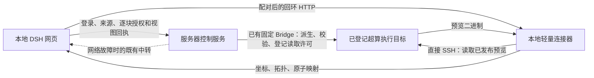

# MDagent HPC-to-local Preview — Design

Status: **LOCAL_IMPLEMENTED_ENGINEERING_VERIFIED / REAL_NETWORK_UNCONFIGURED**. 用户于2026-10-12审阅后确认“设计符合，继续写实施计划”。

日期：2026-10-12。工作区：`/Users/a0000/项目/auto-md/mdagent-web-visualization`。本设计在已完成的网页可视化实现上增加一条取数通道；原实现的本地验收记录见 [现有交付报告](../reports/2026-10-12-web-visualization-low-bandwidth.md)。本文件中的新接口、数字和交互均为设计或验收目标。

## 1. 目标与已确认条件

用户希望继续在现有 DSH 网页中查看结构和轨迹，同时让预览坐标直接从超算到本地，避开服务器两侧的带宽瓶颈。用户确认本地可以直连超算，并接受运行轻量连接器、继续在网页操作。

本轮补充确认：目前没有可提供的 SSH 连接配置、DSH 测试实例或现成 previewId。因此已确认的是使用意愿与连接可能性，具体 SSH 路径、登录身份、可读目录和带宽仍待配置后验证。不能把“可以连接登录节点”当作“已能访问当前登记的执行目标及预览目录”。

需求：

- 网页入口、Molstar、播放、选择、真实源帧/时间和 Agent 实际视图回执继续使用现有实现。
- 服务器继续负责登录、Bio scoped-session、目标/项目归属、来源接受状态和科学操作审批。
- 已发布预览的坐标、拓扑及原子映射通过本地 SSH 通道读取；控制 JSON 和前端静态资源继续由服务器提供。
- 下载与渲染保留来源、manifest、文件哈希及原子映射校验；来源或权限变化使后续取数停止。
- 连接器失联等可恢复传输故障可退回原中转；身份、权限、来源或完整性错误保持拒绝。
- 原始轨迹、checkpoint、科学环境和现有用户文件继续保留。测速使用已有预览，不启动生产 MD。

## 2. 当前状态与最小改动位置

当前路径是浏览器 → cloud 同源路由 → 私有 Bio relay → 固定 Bridge → 最终计算节点。坐标经过 cloud 的共享 4 Mbps 预算；当前实现已做本地 WebGL 和 5 Mbps 工程验收，尚未部署到真实服务器/超算。

| 当前组件 | 与本设计有关的行为 |
| --- | --- |
| `bio-agent/web/visualization/src/transport.mjs` | 同源控制与二进制请求写在一个 transport 中；已有取消、两请求上限、64 MiB 内存缓存和文件 SHA-256 校验 |
| `cloud/bio_preview.py` | 登录归属和会话检查、按块转发预览；控制与资源继续复用此入口 |
| `bio-agent/web/runtime/visualization/preview-api.mjs` | 原 11 个 scoped Bio 工具资格、目标哈希及 Project guard 在异步操作前后检查 |
| `bio-agent/web/runtime/visualization/preview-relay.mjs` | 仅回环、私有 world token；不适合直接提供给浏览器或本地连接器 |
| `bio-agent/src/bioagent/visualization/service.py` | 仅 READY 预览可读；接受 revision、源文件指纹、文件大小与读取前后状态检查 |
| `bio-agent/src/bioagent/execution_target.py` | 执行身份绑定 host、UID、Python、release 和项目根；不同登录节点不能自动视为同一执行目标 |

本机只读预检发现 OpenSSH 10.3p1、SFTP 和 Node 26.7.0 已有；`/Users/a0000/.ssh/config` 不存在，compute-context-memory 没有匹配记录。仓库 `connection.example.json` / `execution-target.example.json` 是占位示例。本轮没有安装依赖、建立 SSH 连接或测速。

## 3. 方案选择

| 方案 | 适用性与代价 | 本轮选择 |
| --- | --- | --- |
| 本地连接器 + 固定 SSH helper | 复用用户 SSH；不用在超算开放公网 HTTP 服务。新增本地配对与只读授权协议 | **首版采用** |
| 超算 HTTPS 文件服务 | 浏览器可直接读；需要中心允许的服务、TLS、网络入口及新的鉴权部署 | 有现成合规服务时再评估 |
| WebRTC / 浏览器扩展 | 需要额外的连接协商或安装维护；是否仍经过 relay 取决于网络 | 首版不引入 |

首版连接器使用现有兼容 Node 与系统 OpenSSH，HTTP、进程和哈希用内置模块。连接器提供小型 CLI 启动及配对流程，界面和渲染仍由 DSH 网页提供。独立安装包、托盘和自动启动另作后续交付；本设计不隐含新依赖安装授权。

## 4. 三端分工与数据路径

服务器仍可把小型控制消息送到超算；大体积预览字节走 SSH → 连接器 → 浏览器。这两个方向分别统计，不能把控制流量也宣称为零。

首版直接读取 **同一已登记执行目标**，保持现有 host/UID/项目/release 核验。SSH 可以使用中心允许的 VPN 或跳板，但实际路由必须确认不经过这台 5 Mbps 服务器。

如果本地可达的仅是另一个登录/数据节点，即使它能看到同一共享文件系统，也不能直接通过当前 execution-target 校验。需要单独登记只读预览出口、验证共享存储与文件身份，并确认中心允许该 helper；该模式作为后续扩展，不在首版自动启用。超算登录节点不承担本功能的轨迹派生或 MD。

## 5. 用户流程和网页状态

1. 在本地配置允许的 DSH Origin 与已有 SSH 连接，再启动连接器；启动输出一次性配对码和回环端口。
2. 在现有 3D 工作台点击“连接本机”，输入配对码；网页在需要时触发浏览器本地网络权限提示。
3. 网页核验连接器版本、会话和目标匹配后显示“超算直连”。结构、播放、定位、详细时间窗照常使用。
4. SSH/VPN 暂不可用时显示“服务器中转”及简短原因；同一来源校验通过后重新取当前文件。
5. 点击断开、关闭视图或切换账号/会话时，取消本次预取、关闭对应 SSH helper、使读取许可和配对会话失效。

默认选择 `auto`：已经配对且检查通过时使用直连，否则使用现有中转。用户可固定 `relay` 便于对照；测速模式 `direct-only` 失败即报错，防止自动回退污染结果。产品仅显示连接方式、缓冲和必要错误，不暴露内部文件路径、令牌或 shell 命令。

## 6. 本地连接器与浏览器边界

连接器只监听 `127.0.0.1`。默认端口 `18773`；占用时明确报错，用户可显式改端口，不扫描其他本地服务。网页只连接已填写的回环端口，不接受服务器下发的任意本地 URL。

- 允许的 DSH Origin 在本地启动配置中固定；Host 必须是准确的 `127.0.0.1:<port>`。拒绝未知 Origin、`null` Origin 和不符合协议的请求。
- 一次性配对码由安全随机数生成，至少 128 bit、有效 120 s、最多 5 次错误尝试。成功后换成仅内存保存、绑定 Origin/浏览器 client/会话代际的本地会话密钥；空闲 15 min 失效。重启连接器或退出账号必须重新配对。
- CORS 只允许固定 Origin 和协议需要的 method/header；预检不发起 SSH 或返回科研数据。二进制响应显式 expose 所需来源/文件/offset 头，网页请求使用 `credentials: 'omit'` 和 `redirect: 'error'`。
- 本地会话密钥与读取许可仅放 header/body；URL、浏览器持久存储、Agent 上下文及日志均不保存。服务器登录 cookie、私有 world token 和 SSH 密钥不转交连接器网页接口。
- 请求体 <=32 KiB，限定 `health/pair/open/read/close`，错误码固定。没有任意路径下载、任意 URL 代理、shell 执行或科学任务入口。

HTTPS 网页访问回环 HTTP 的可用性需要实际浏览器验证：CORS、页面/代理 CSP、安全上下文、Permissions-Policy 和本地网络访问许可都可能影响结果。对支持的浏览器可按规范使用 `targetAddressSpace: 'loopback'`；不通过关闭安全功能、通配 CORS 或要求忽略证书错误实现连接。[MDN CORS](https://developer.mozilla.org/en-US/docs/Web/HTTP/Guides/CORS)、[MDN Local network access](https://developer.mozilla.org/en-US/docs/Web/Security/Defenses/Local_network_access)支持这些协议要求，不能替代本项目的兼容性验收。

先验收当前安装的 Chrome/Edge 版本，再记录用户日常浏览器的结果；未通过的浏览器继续使用中转。移动端和连接器安装包适配不是首版验收范围。

## 7. SSH 取数与身份核验

本地配置将服务器公开的 `targetId` 映射到用户已有 SSH alias/config、known_hosts 和固定 helper 路径。网页与模型只传引用，不传 hostname、私钥路径、Python 路径或项目目录。

OpenSSH 保留 host-key 检查，使用无 TTY 的固定 helper 和有界 stdin/stdout 协议，关闭 agent forwarding 及无关端口转发。非交互 SSH 不满足登录要求时停止直连并显示需要先完成本地登录；不自动更改 SSH 配置或 known_hosts。若复用已有 ControlMaster，必须是用户配置的连接且控制 socket 归属/权限有效。[OpenSSH ssh](https://man.openbsd.org/ssh.1)、[ssh_config](https://man.openbsd.org/ssh_config.5)。

本地进程 spawn 使用参数数组。SSH 的远程命令仍可能经远端 shell 解释，因此固定 helper/解释器路径必须来自受保护的 operator 配置并正确引用；任何浏览器字段都只放协议 stdin，不拼进远程命令。

握手同时检查 OpenSSH 所连接主机的 host key，以及 helper 返回的 `hostIdentitySha256`、UID、executionTargetSha256、项目绑定和 reader 版本。机器身份哈希与 SSH host-key 指纹是不同字段，不能互相替代。与服务器预期不一致时拒绝取数。

每个连接器最多 2 条活动 SSH helper 通道，复用已建立连接，避免每个 64 KiB 块重新 SSH 登录。helper 只支持握手、消费服务器登记的读取许可和关闭；不调用 `prepare/window/submit`。stdout 使用长度限定的元数据和原始二进制 framing，单个数据 frame <=64 KiB，错误只返回固定码。无需在超算新增监听端口。

## 8. 逐块许可与撤销

首版采用 **服务器登记的短时、单次、固定范围读取许可**，避免新增跨端长期签名密钥。许可通过现有私有 Bridge 写入当前项目的独立运行态记录，本地 helper 只能消费已登记记录；持有本地配对会话不能自行签发许可。

拟新增控制动作 `direct-open / direct-permit / direct-close`，默认配置关闭。开启后复用原账号归属、原 11 个 scoped Bio 工具资格、Project guard、agent 实例及执行目标检查；新增这些内部动作不授予模型更多科学权限。

许可绑定：owner、Bio session/agent 代际、client/viewport、channel、node、target hash/revision、项目、完整 SourceRef、previewId、manifest 哈希、fileId/文件 SHA-256/总大小，以及唯一 offset/length。返回随机 opaque handle；计算端仅保存 handle 摘要及绑定。浏览器不填写 owner 或项目路径。

单次流程：

1. 浏览器向同源控制接口请求当前块许可。服务器检查权限，计算端确认 READY、接受 revision、当前来源和 manifest 文件条目。
2. 计算端登记许可；服务器异步返回前再次检查原 agent/scopes/target。检查失败不得返回句柄，并尝试通过原控制通道撤销；撤销消息未能送达时，已登记许可仍受5 s硬期限限制。
3. 浏览器向已配对连接器提交许可；helper 原子认领，同一许可不能在第二条连接重放。
4. helper 按固定范围读取，保留现有防路径逃逸、`O_NOFOLLOW`、文件大小、读取前后指纹和来源 current 检查；每个 <=64 KiB frame 检查许可有效性和取消状态。
5. 文件完成后浏览器验证完整 SHA-256、大小、来源、原子映射和真实帧信息，调用现有同源 `describe` 复核来源后才交给 renderer。显示命令仍由实际浏览器回执判定完成。

先取得连接器的传输槽位，再申请许可，避免排队消耗许可寿命。有效会话中的单纯过期允许对同一范围重新授权一次；再次过期返回明确超时，不无限重试。重新授权仍拒绝时停止，不能解释成网络故障。5 s期限由计算端核验，本地时钟不能延长授权。

| 许可与流量限制 | 首版值 |
| --- | --- |
| 单次许可范围 | <=256 KiB，精确 offset/length；不授权整个目录或原始 DCD |
| 许可寿命 | 登记后最多 5 s，消费中继续检查；过期需重新授权 |
| 在途数 | 每 viewport <=2；连接器全局 <=2；待处理队列 <=32，当前帧优先且视图间公平 |
| 控制记录 | 每活动 channel 固定两个槽位、原子更新与锁；失效 nonce 不可复用。记录数量受活动会话上限约束 |
| 连接器预览缓冲 | 全局 <=1 MiB；首版不增加落盘坐标缓存 |
| 浏览器缓存/解码窗口 | 沿用现有64 MiB文件缓存及当前/预取窗口限制；来源或会话失效时停止新读并清除对应缓存 |

撤销无法收回已经进入浏览器内存的坐标。新许可必须实时经过服务器；已有许可最多两个、各 <=256 KiB、最多存活 5 s，显式关闭通过已有控制通道撤销槽位。以读取 frame 为粒度停止后续发送，测试中报告在途残余和实测停止延迟，不声称撤销瞬间物理收回所有网络字节。

授权失败、服务器失联或控制请求超时后不领取新许可。首版不提供离线新取数。许可重放、账号/会话替换、目标变化、损坏数据或 SourceRef 失效都拒绝直连和中转；不能靠降级绕过拒绝。

## 9. Transport 接入、缓存和回退

将 browser transport 拆为同源 control client 与可替换 binary provider；`api(action)` 继续走服务器，`getFile(manifest, fileId)` 保留原调用方式及完整文件校验。relay provider 包装现有 GET，direct provider 领取许可后调用回环 POST 并返回同样的二进制/身份头。

浏览器缓存按 owner/session 代际、target、完整 SourceRef、manifest 和文件哈希绑定，不能仅凭相同 fileId 或 SHA 在不同授权会话中复用。缓存命中仍受当前来源/权限检查；无新服务器确认时不把旧缓存作为新 Agent 操作成功回执。

可以降级的情况：连接器未运行、浏览器本地访问被拒、VPN/SSH连接不可达或中断。自动降级前再次同源授权、确认同一 SourceRef/manifest/file 哈希，取消直连，在中转上从头重取未完整校验的当前文件；已验证文件保持缓存。未能可靠区分传输故障与身份错误时保持拒绝并要求重新检查。

禁止降级的情况：主机身份不符、未知目标、读取许可拒绝/重放、scope/来源变化、文件哈希或原子映射错误。关闭视图/换会话后的迟到响应不能复活视图、预取或 SSH 通道。

## 10. 性能预算与预期边界

5 Mbps 理论上限是625,000 B/s，现有中转预览预算4 Mbps对应500,000 B/s，均未扣协议开销。直连只消除大体积预览经过该出口的限制；实际速度还受本地/VPN/超算线路、SSH建连、HPC存储和授权往返影响。

中转及服务器静态资源继续计入原全局4 Mbps预算；新增授权 JSON也计入。直连预览不领服务器的坐标发送预算，按连接器并发和取消策略调度。服务器出口计数分别报告控制、静态资源、中转数据；连接器单独报告直连坐标字节。

逐块许可保留控制延迟。两个在途请求、每块B字节、许可耗时Tc、直传耗时Td时，吞吐上限约为 `2 * B / (Tc + Td)`，还需扣除共享队列和存储开销。若Tc达到1 s，256 KiB块的控制瓶颈约4.19 Mbps；即使SSH快，首版也可能无法明显提速。测速必须包含完整许可链；若此项成为瓶颈，再另行评审更大有界块或短租约，不能直接删除授权检查。

DSH/Molstar首次JS/CSS冷加载仍经过服务器，直连不等于首次开网页必然提速。已缓存帧的渲染FPS取决于本地设备；改善重点是首次坐标加载、详细时间窗和多视图取数等待。没有真实测量前不承诺倍数或“任意大体系实时播放”。

## 11. 验证方案和启用条件

### 11.1 本地工程验证

先用已有 Node、OpenSSH、Python环境及有界测试数据完成：许可发放/单次消费/过期/取消、跨账号与scope撤销、target/manifest/source错配、目录逃逸/symlink、响应损坏、SSH断线、源文件替换、迟到响应、队列公平性。运行现有预览/显示与Bio远程生命周期相关回归。

真实浏览器验证HTTPS DSH测试页到回环HTTP的许可、CORS/CSP、deny/revoke/reload路径；记录浏览器和OS精确版本，不用同一localhost测试页或关闭安全策略代替。未配置HTTPS测试入口时，该项保持待验收。

### 11.2 同一份预览的真实网络对照

开始条件：已有获授权的DSH测试部署；本地SSH/VPN配置、host身份、目标/项目绑定和中心允许的helper已确认；已发布预览可读。没有这些条件，只能做工程模拟，不填真实网络结论。

1. 选择一份现有READY预览，冻结 SourceRef、manifest和文件SHA；不改原始数据，不生成生产轨迹。
2. 先用一次有界SSH只读下载确认物理路径吞吐及哈希，再用完整产品许可链测试。前者不代替后者。
3. 同一批 <=16 MiB预览文件，relay与direct-only交替各3次，分别控制浏览器预览缓存为空/已热。整个真实网络验收的预览下载总量硬上限512 MiB；达到上限停止并报告未完成项目。长程MD、完整原始DCD或大型新数据集不参与。
4. 网络比较预览数据；再单独测JS/CSS冷与暖两组用户流程。记录SSH冷建连、许可RTT、首个有效结构、首次播放、详细窗等待和完整文件吞吐。
5. 1/3/5视图各持续180 s，记录真实源帧/时间、卡顿、每视图吞吐、公平性、服务器出口和连接器坐标字节。relay使用共享5 Mbps/100 ms RTT工程条件；真实链路的实际带宽/RTT单独记录。
6. 中途断VPN、关闭连接器、撤销scope、切换账号/目标和替换源，检查停止与降级策略。工程注入与真实网络事件分开标记。

所有结果保存到新的独立evidence目录，保留原文件前后哈希；日志不含cookie、许可句柄、配对码、world token或SSH凭据。未完成的项目写PENDING，不用模型估算填测量栏。

| 验收项 | 判断标准 |
| --- | --- |
| 科学数据绑定 | 两路径文件SHA、原子映射、SourceRef、源帧/时间完全一致；原始科学文件哈希不变 |
| 绕开服务器 | direct-only坐标字节由连接器/HPC通道记录，服务器不转发这些文件；控制和静态资源流量另报 |
| 相对性能 | 报真实对照结果。目标：冷预览文件取数或详细窗等待中位数至少改善30%；未达到则不宣传提速，先定位链路或许可延迟 |
| 现有体验 | 继承参考轻量预览的暖结构<=4 s、播放<=6 s、缓存卡顿<=1%目标；派生/源首次验证与整站冷启动独立计时 |
| 权限与错误 | scope/身份/来源/完整性错误拒绝后续数据和成功回执；旧许可寿命/范围/重放及取消符合第8节 |
| 故障恢复 | 可恢复网络错误在同源授权和同一manifest核验后回退；direct-only明确失败，不偷换测试路径 |
| 浏览器与部署 | 至少一个实际桌面浏览器、HTTPS测试入口、真实SSH目标完整通过后才启用直连；其他浏览器标注已验/待验 |

## 12. 实施顺序与待确认事项

设计通过后再写实施计划：先实现有界只读许可/固定helper及负面测试，再实现本地配对/SSH生命周期，最后接入binary provider、网页状态和真实浏览器/网络对照。默认功能关闭，测试实例通过后才安排部署启用。

当前待确认的是实际SSH命令/config、VPN/跳板路由、最终执行目标与登录节点是否相同、预览可读目录、日常浏览器，以及可用于HTTPS验收的DSH测试实例。用户说明暂时都没有；这些不妨碍后续本地工程实现，但阻止真实超算测速与“已经提速”的交付结论。

本次审阅的具体选择：现有网页 + 轻量本地连接器；固定SSH helper、同一登记执行目标；逐块短时许可；沿用网页缓存；可恢复网络错误中转；权限/来源错误拒绝；真实性能对照后再启用。不自动commit、push、生产部署、安装新依赖或清理既有产物。

本轮自审关注：真实连接事实与设计分开；登录节点/执行目标身份边界；许可撤销与在途字节上限；浏览器HTTPS到回环HTTP验收；元数据授权RTT对提速的限制；不复用跨会话缓存或把中转结果混入直连测速。
